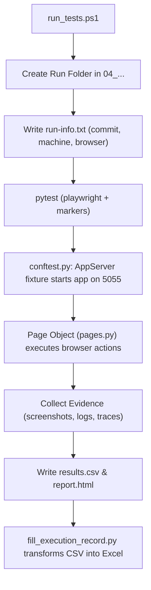

# Final Testing Workflow & Comprehensive Project Record

**Project:** Full-Stack Prediction Platform (ML vs DL vs QML)  
**Role:** Independent Black-Box System Tester  
**Tester:** Ravi Teja (Ravi S)  
**Document ID:** `FINAL_WORKFLOW.md`  
**Repository:** `SE-MINI-PROJECT` (branch: `testing`, build commit: `61fc217`)  
**Date of Record:** 17 November 2026  
**Final QA Verdict:** **READY FOR ACCEPTANCE EVALUATION** (Run 9: **50 / 50 PASS**, 100% Pass Rate)

---

## Table of Contents

1. [Tester Role and Responsibilities](#1-tester-role-and-responsibilities)
2. [Understanding the Application](#2-understanding-the-application)
3. [Requirement Analysis and Test Planning](#3-requirement-analysis-and-test-planning)
4. [Test Case Design](#4-test-case-design)
5. [Requirements Traceability Matrix (RTM)](#5-requirements-traceability-matrix-rtm)
6. [Test Environment and Tools](#6-test-environment-and-tools)
7. [Automation Architecture](#7-automation-architecture)
8. [System Testing Execution](#8-system-testing-execution)
9. [Integration Testing](#9-integration-testing)
10. [API Testing](#10-api-testing)
11. [Defect Management](#11-defect-management)
12. [Regression Testing & Execution History](#12-regression-testing--execution-history)
13. [Test Results and Evidence](#13-test-results-and-evidence)
14. [Testing Pipeline](#14-testing-pipeline)
15. [Demonstration Procedure](#15-demonstration-procedure)
16. [Honest Limitations and Pending Approvals](#16-honest-limitations-and-pending-approvals)

---

## 1. Tester Role and Responsibilities

This project follows a strict division of responsibilities between development and quality assurance:

| Dimension | Development Team | Independent System Tester |
|---|---|---|
| **Personnel** | Aaditya Vijaywargi, Anish Kumar, Arya Devang | **Ravi Teja (Ravi S)** |
| **Ownership** | Core application source (`app.py`, `config.py`, `core/`, `static/`, `tools/`) and unit/integration tests (`tests/`) | Testing module (`testing-docs/`), test plans, test cases, automation framework, execution evidence, defect logs, and final QA reports |
| **Testing Level** | Unit testing, internal module integration, white-box developer testing (`pytest tests/`) | System-level black-box testing, UI/UX automation, boundary value analysis, performance benchmarks, and end-to-end regression |
| **Testing Perspective**| Code structure, coverage, internal logic, mocks | User workflows, specification compliance (SRS/STP), browser rendering, security boundaries, defect reporting |
| **Modification Rights**| Full authority to modify and refactor application code | **Strict Black-Box Rule:** No arbitrary application code modifications during testing; all discrepancies raised as formal defects for developer review |

### Ground Rules Followed Throughout Testing
1. **Application Source Integrity:** No application source file was altered without formal defect tracking and verification.
2. **Preservation of Original Evidence:** All previous drafts, specifications (`SRS v1.0`, `STP v1.0`), and execution runs (Runs 1 through 9) are preserved on disk.
3. **No Fabricated Results:** No test was marked `PASS` based on assumptions. When visual confirmation was pending on fast-running stages, cases were recorded strictly as `UNVERIFIED` until concrete evidence was collected.
4. **Local Isolation:** The automated test suite executes exclusively against a local test instance (`127.0.0.1:5055`), preventing accidental execution against staging or production environments.

---

## 2. Understanding the Application

The **Full-Stack Prediction Platform** is a web-based benchmarking and classification system that compares classical Machine Learning (ML), Deep Learning (DL), and Quantum Machine Learning (QML) models on user-supplied tabular datasets.

```
┌────────────────────────────────────────────────────────────────────────────────────────┐
│                                APPLICATION ARCHITECTURE                               │
├─────────────────┬──────────────────────┬─────────────────────────┬─────────────────────┤
│ 1. INGESTION    │ 2. PROFILING & PREP  │ 3. ASYNC TRAINING       │ 4. RESULTS & EXPORT │
│ CSV / Excel     │ Missing imputation   │ JobRunner (thread)      │ Top model banner    │
│ Drag-and-drop   │ One-hot encoding     │ 6 ML (scikit-learn/XGB) │ Metrics table       │
│ Client checks   │ Standard scaling     │ 1 DL (Keras DNN)        │ Confusion matrices  │
│ Server checks   │ PCA (95% variance)   │ 1 QML (PennyLane VQC)   │ ROC / PR / Time     │
│ Sample datasets │ Stratified splitting │ Status polling (2s)     │ Formula-safe CSV    │
└─────────────────┴──────────────────────┴─────────────────────────┴─────────────────────┘
```

### Seven Core System Lifecycle Stages

1. **Dataset Upload (`POST /api/upload`):** Accepts `.csv` and `.xlsx` files. Validates file size (≤ 100 MB client/server), minimum rows (≥ 50), minimum columns (≥ 2), and extension safety. Rejects executables, double extensions (`.csv.exe`), and empty files.
2. **Data Profiling & Preprocessing (`core/profiling.py`, `core/preprocessing.py`):** Automatically detects column types, missing values, constant columns, and unique identifiers. Applies median/mode imputation, one-hot encoding for categoricals, standard scaling, and PCA compression retaining 95% variance. Generates an MD5 split fingerprint for dataset auditability.
3. **Target Analysis (`core/targets.py`):** Recommends the most suitable target column. Categorizes tasks as Binary or Multi-class. Detects class imbalance and surfaces a warning when class ratio exceeds 3:1. Automatically disables QML for multi-class targets.
4. **Model Configuration (`static/js/config.js`):** Supports 8 distinct models:
   - *Classical ML:* Logistic Regression, Decision Tree, Random Forest, SVM (with 20k-row stratified subsampling), Naive Bayes, XGBoost (with CUDA GPU support).
   - *Deep Learning:* Keras Multi-Layer DNN (128→64 dense layers, dropout, validation split, early stopping with patience 5).
   - *Quantum ML:* PennyLane Variational Quantum Classifier (VQC) with AngleEmbedding and StronglyEntanglingLayers on `default.qubit` (binary-only, capped at 2,000 training rows).
   - *Advanced Settings:* Qubits (2–8), DNN epochs (1–500), QML epochs (1–100), decision thresholds (0.01–0.99 or auto-tuned), random seed, test split ratio, and class balancing.
5. **Training Execution (`core/jobs.py`, `app.py`):** An asynchronous in-process background worker (`JobRunner`) trains selected models sequentially, logging per-stage progress (`Preparing`, `Training <model>`, `Testing <model>`, `Evaluating`, `Completed`).
6. **Results & Visualization (`static/js/results.js`, `charts.js`):** Renders the winning model (ranked by PR-AUC for binary, F1 for multi-class), sortable comparison table, confusion matrices, and paradigm-colored Chart.js visualizations (ROC, PR, and horizontal log-scale training time). Includes graceful fallback when external CDN scripts are blocked.
7. **CSV Export (`core/export.py`):** Generates a downloadable model benchmark CSV. Enforces spreadsheet formula-injection protection by sanitizing cells starting with `=`, `+`, `-`, `@`, `\t`, or `\r`.

---

## 3. Requirement Analysis and Test Planning

### Evolution of Specifications

Testing was planned and baselined against formal requirements:

- **SRS v1.0 → SRS v1.1 → SRS v1.2:**
  - Evaluated against 29 deviations documented in `docs/deviations.md`.
  - Added 24 requirement corrections (`S1` to `S24`), defining missing target validation (`REQ-PP-11` to `REQ-PP-13`), class balancing (`REQ-TR-9`), decision threshold tuning (`REQ-EV-6`), and measured performance baselines (`PERF-1` to `PERF-8`).
  - Formalized in `testing-docs/01_Test_Documentation/SRS/SRS_Full_Stack_Prediction_Platform_v1.2.docx`.

- **STP v1.0 → STP v2.0 → STP v2.1 → STP v2.2:**
  - Fully restructured under **IEEE 829** standard (Sections 1 through 19 + Appendices A–E).
  - Renamed Section 8.8 to **"Retesting After Defect Fixes"** per faculty requirement.
  - Added Section 8.10 detailing Playwright browser automation architecture.
  - Added Section 8.11 defining 14 measurable ML/DL/QML performance tuning checks (`P1` to `P14`).
  - Formalized in `testing-docs/01_Test_Documentation/STP/STP_Full_Stack_Prediction_Platform_v2.2.docx`.

---

## 4. Test Case Design

The system test suite comprises **50 black-box system test cases** (`ST-01` to `ST-50`) documented in `testing-docs/01_Test_Documentation/Test_Cases/System_Test_Cases.xlsx` (revision 1.2).

Each case follows the 10-field IEEE 829 format:
`Test Case ID`, `Requirement ID`, `Test Scenario`, `Preconditions`, `Test Steps`, `Test Data`, `Expected Result`, `Actual Result`, `PASS/FAIL`, `Priority`.

### Breakdown by Functional Group

| Group | Case Range | Count | Primary Objective | Key Verification |
|---|---|---|---|---|
| **A. Upload & Validation** | ST-01 – ST-08 | 8 | File integrity & boundary checks | File picker, drag-and-drop, `.xlsx`, `.csv.exe` rejection, 100 MB limit, 49/50 row boundary |
| **B. Profiling & Preprocessing** | ST-09 – ST-12 | 4 | Dataset characterization | 4 sample datasets, identifier/constant column flags, missing values, split fingerprint |
| **C. Target Selection** | ST-13 – ST-19 | 7 | Target configuration | Target preselection, task analysis, 3:1 imbalance warning, unsupported types, QML toggle |
| **D. Advanced Tuning Settings** | ST-20 – ST-25 | 6 | Boundary value analysis | Qubits (2–8), DNN epochs (1–500), QML epochs (1–100), thresholds (0.01–0.99), test split, seed |
| **E. Training Execution** | ST-26 – ST-35 | 10 | Model training pipeline | 8-model binary run, 7-model multi-class run, seed reproducibility, DNN early stopping, QML 2k cap, SVM subsampling, GPU detection |
| **F. Progress & Cancellation** | ST-36 – ST-39 | 4 | Async job lifecycle | Stage transitions, cancel during training, cancel before start, single job per session |
| **G. Results Dashboard** | ST-40 – ST-43 | 4 | Visualizations & metrics | Winner banner, table sorting, Chart.js curves & baselines, confusion matrices |
| **H. CSV Export** | ST-44 – ST-45 | 2 | Reporting & export security | Metrics export, Excel formula-injection safety verified via COM automation |
| **I. Security & Error Handling** | ST-46 – ST-47 | 2 | API robustness | Path traversal, invalid routes, server down message, dataset expiration |
| **J. UI/UX & Accessibility** | ST-48 – ST-49 | 2 | Cross-browser & accessibility | 52 keyboard focus stops (WCAG contrast ≥ 3:1, outline ≥ 2px), Chrome/Edge/Chromium responsive layout |
| **K. Performance Benchmarks** | ST-50 | 1 | Response times | Sub-millisecond timing validation against PERF-1 through PERF-8 |

### Test Data Corpus (`testing-docs/03_Test_Data/`)

Generated deterministically via `make_test_data.py` (seed 42):
- `TD-01`: Disallowed `.txt` extension
- `TD-02`: Look-alike `.csv.exe` double extension
- `TD-03`: Clean Excel `.xlsx` workbook
- `TD-04` / `TD-05`: Boundary datasets (49 rows rejected / 50 rows accepted)
- `TD-06`: Single-column CSV rejected
- `TD-07` / `TD-08`: Empty file and corrupt binary Excel
- `TD-09` / `TD-10`: Imbalance ratio boundary (4:1 warning displayed / 3:1 no warning)
- `TD-11`: Single-row class blocking stratified splitting
- `TD-12`: 40,000-row tabular dataset for QML row cap, SVM subsampling, and cancellation
- `TD-13`: CSV formula-injection payload (`=SUM(1,1).csv`)
- `TD-14`: Dynamically generated 101 MB file for upload limit enforcement
- `TD-15`: Dynamically generated 25,000-row slice for boundary verification

---

## 5. Requirements Traceability Matrix (RTM)

The Requirements Traceability Matrix is formalized in `testing-docs/01_Test_Documentation/Test_Cases/Requirements_Traceability_Matrix.xlsx` (FSPP-RTM-01 v1.0).

### Traceability Architecture
- **Forward Traceability:** SRS Requirement → System Test Case → Automation Script → Execution Status.
- **Backward Traceability:** Test Case / Execution Record → Requirement ID.

### Requirement Family Coverage Summary

| Family | Total Reqs | System Test (Direct) | System Test (Indirect) | Dev Tests Only | Uncovered / Review Only | System Coverage |
|---|---|---|---|---|---|---|
| **REQ-TG** (Target Selection) | 6 | 6 | 0 | 0 | 0 | **100%** |
| **REQ-MS** (Model Selection) | 5 | 5 | 0 | 0 | 0 | **100%** |
| **REQ-EV** (Evaluation & Metrics) | 6 | 6 | 0 | 0 | 0 | **100%** |
| **REQ-UP** (Dataset Upload) | 9 | 8 | 0 | 1 | 0 | **89%** |
| **REQ-TR** (Model Training) | 9 | 8 | 0 | 1 | 0 | **89%** |
| **REQ-JB** (Job Execution) | 8 | 7 | 0 | 1 | 0 | **88%** |
| **UI** (User Interface) | 7 | 6 | 0 | 0 | 1 | **86%** |
| **REQ-PP** (Preprocessing) | 13 | 10 | 0 | 3 | 0 | **77%** |
| **COM** (System Communication) | 4 | 2 | 0 | 1 | 1 | **50%** |
| **CON** (Constraints) | 7 | 1 | 1 | 0 | 5 | **29%** |

### Honest Accounting of Uncovered Requirements
- **Constraints (CON-1, CON-2, CON-3):** Architectural guidelines (no Node.js bundler, scikit-learn/Keras/PennyLane backend, Python 3.11) verified by repository inspection rather than automated dynamic tests.
- **DevOps / Operations (OTH-1 to OTH-7):** Container build (`OTH-2`), Render deployment (`OTH-3`), console stdout logging (`OTH-4`), and branching model (`OTH-5`) belong to developer DevOps scope, not system testing.

---

## 6. Test Environment and Tools

The testing suite operates in an isolated environment on a dedicated port:

```
┌────────────────────────────────────────────────────────────────────────┐
│                        HARDWARE & OS SPECIFICATIONS                    │
├─────────────────┬──────────────────────────────────────────────────────┤
│ Machine Name    │ RAVI_TEJA                                            │
│ Processor       │ AMD Ryzen 5 7535HS (6 cores, 12 threads)             │
│ Memory          │ 15.3 GB Physical RAM                                 │
│ Graphics / CUDA │ NVIDIA GeForce RTX 3050 Laptop GPU (Driver 566.07)   │
│ Operating System│ Microsoft Windows 11 Home Single Language (x64)     │
└─────────────────┴──────────────────────────────────────────────────────┘
```

### Software Tooling Stack

| Tool | Version | Technical Purpose |
|---|---|---|
| **Python** | 3.11.9 | Base runtime for the application and isolated test environment |
| **Flask** | 3.0.x | Web framework powering the System Under Test (`app.py`) |
| **Playwright** | 1.65.0 | Browser automation engine driving Chrome, Edge, and Chromium |
| **pytest** | 9.2.0 | Test execution framework with markers (`@pytest.mark.st`) |
| **pytest-playwright** | 0.10.0 | Fixture integration providing browser isolation and tracing |
| **pytest-html** | 4.2.0 | Standalone self-contained HTML report generation |
| **openpyxl** | 3.1.5 | Programmatic generation and maintenance of Excel workbooks |
| **Microsoft Excel (COM)**| Installed | Out-of-process spreadsheet validation for formula safety (ST-45) |
| **nvidia-smi** | Driver CLI | Hardware GPU acceleration verification for XGBoost (ST-35) |
| **measure_times.py** | Project Tool | Sub-millisecond benchmarking of API endpoints (ST-50) |

### Isolated Test Server Configuration
- The test harness launches `app.py` in a separate process via `conftest.py`.
- **Port:** `5055` (avoids colliding with developer instances running on port 5000).
- **Environment:** `COMPUTE_DEVICE=cpu` (ensures repeatable CPU baseline; restarted with `COMPUTE_DEVICE=auto` specifically for ST-35).
- **Upload Directory:** Isolated directly inside each run's evidence directory.
- **Security Guard:** `conftest.py` strictly refuses requests to any domain other than `127.0.0.1` and `localhost`.

---

## 7. Automation Architecture

All test automation is cleanly partitioned in `testing-docs/02_Test_Automation/`:

```
testing-docs/02_Test_Automation/
├── run_tests.ps1                  # Master runner: creates run folder & invokes pytest
├── pytest.ini                     # Pytest configuration, custom markers, Chrome channel
├── conftest.py                    # AppServer fixture, Evidence capture, results.csv hook
├── pages.py                       # Page Object Model (App class, locators, stage polling)
├── settings.py                    # Port 5055, base URL, directory paths, host whitelist
├── fill_execution_record.py       # Automated ETL from results.csv into formal Excel record
├── requirements-e2e.txt           # Pinned test dependencies
└── tests/                         # 11 test modules covering ST-01 through ST-50
```

### Complete Execution Pipeline



### Page Object Pattern (`pages.py`)
- Centralizes UI locators to prevent fragile inline selectors.
- Uses `text_content` rather than `inner_text` to avoid false assertion failures caused by CSS `text-transform: uppercase`.
- Implements `record_training(poll_interval=0.1)` to capture fast-moving server-side stage transitions in real time.
- Implements `wait_model_status()` to monitor individual model execution in the progress checklist.

---

## 8. System Testing Execution

The 50 test cases were executed systematically across all system boundaries:

### Highlights of Key Validations
- **Boundary Rows (ST-07):** Evaluated exact boundary behavior: `TD-04` (49 rows) rejected with clear toast message; `TD-05` (50 rows) accepted and profiled.
- **Executable Injection (ST-04):** Verified rejection of `.csv.exe` double extension.
- **File Size Guard (ST-05):** Verified immediate client-side rejection of 101 MB file (`TD-14`) before network transfer.
- **Reproducibility (ST-28):** Executed seed 42 twice and seed 7 once; validated that identical seeds produce matching MD5 split fingerprints (`ba7ba92f3866e20f`) and metrics.
- **DNN Early Stopping (ST-29):** Verified early stopping triggered at epoch 5 with patience 5, correctly recording `stopped_early: no` and parameters (12,289).
- **QML Row Cap (ST-31):** Evaluated TD-12 (40,000 rows); confirmed QML training rows strictly capped at 2,000 (subsampled), test rows 8,000.
- **Formula Injection Safety (ST-45):** Exported dataset named `=SUM(1,1).csv`. Opened exported CSV via Windows Excel COM automation; verified 0 formula cells and 0 error cells.
- **Accessibility & Keyboard Navigation (ST-48):** Evaluated 52 interactive focus stops. Verified 2px visible focus outline and WCAG contrast ratios between 6.09:1 and 6.64:1 (exceeding ≥ 3:1 requirement).
- **Responsive Viewports (ST-49):** Tested Chrome, Edge, and Chromium across desktop (1366×768) and mobile (375×812) viewports.

---

## 9. Integration Testing

Documented in `testing-docs/06_Final_Reports/Integration_Testing_Summary.xlsx` (FSPP-ITS-01 v1.0).

Integration testing verifies interactions across **8 architectural boundaries**:
- **Boundary A:** Upload, storage, and profiling
- **Boundary B:** Sample datasets
- **Boundary C:** Target selection and task analysis
- **Boundary D:** Training pipeline and preprocessing
- **Boundary E:** Job runner, polling, and cancellation
- **Boundary F:** Results, charts, and evaluation
- **Boundary G:** CSV export
- **Boundary H:** Error handling and security

### Strict Separation: 26 Documented Scenarios

| Level | Count | Mechanism | Scope |
|---|---|---|---|
| **Independent System Tests** | **17** | Black-box browser automation (Playwright + pytest) against live Flask server | Real DOM events, browser session cookies, HTTP requests, UI stage transitions |
| **Developer Integration Tests**| **9** | White-box integration tests (`tests/test_api.py`) via Flask test client | In-process HTTP route handling, route parameters, response payloads, mock error conditions |

Every scenario references concrete test IDs, expected results, and actual execution evidence.

---

## 10. API Testing

Documented in `testing-docs/06_Final_Reports/API_Testing_Summary.xlsx` (FSPP-ATS-01 v1.0).

Covers all **10 REST API Endpoints** defined in SRS Section 3.3 across **26 discrete checks**:

| Endpoint | Method | Verified Status Codes | Tested By | System Test Reference |
|---|---|---|---|---|
| `/api/health` | GET | `200` | Fixture (all runs) | All automated runs |
| `/api/samples` | GET | `200` | System test | ST-09 |
| `/api/samples/<name>` | POST | `201`, `405` | System test | ST-09, ST-46 |
| `/api/upload` | POST | `201`, `400` | System test | ST-01 to ST-08, ST-11, ST-50 |
| `/api/configure` | POST | `200`, `404` | System test | ST-13 to ST-18, ST-46, ST-50 |
| `/api/train` | POST | `202`, `404`, `409` | System test | ST-26 to ST-39, ST-47, ST-50 |
| `/api/status/<job_id>` | GET | `200`, `404` | System test | ST-36, ST-46, ST-50 (polling) |
| `/api/cancel/<job_id>` | POST | `202`, `409` | System test | ST-37, ST-38, ST-46 |
| `/api/results/<job_id>` | GET | `200` | System test | ST-26, ST-27, ST-40 to ST-43, ST-50 |
| `/api/results/<job_id>/csv`| GET | `200` | System test | ST-44, ST-45 |

All status codes were verified against actual execution logs (`app-server.log`).

---

## 11. Defect Management

Formal defect tracking is recorded in:
- `testing-docs/05_Defect_Management/Defect_Log.xlsx`
- `testing-docs/05_Defect_Management/Developer_Review_v1.1.docx`

### Defect Lifecycle Summary

| Defect ID | Case | Severity | Description | Root Cause | Status |
|---|---|---|---|---|---|
| **DEF-01** | ST-33 | **Major** | Start training button stays disabled after clicking *"← Change models"* | `config.js` `onStartTraining()` disabled button without re-enabling; `#opt-balance` had no change listener | **CLOSED** (Fixed in `config.js`, retested PASS in Run 4 & Run 9) |
| **DEF-02** | ST-34 | Minor | SVM subsampling warning displayed for 25,000 rows, but SVM trained on all rows | `config.js` counted total rows (`> 20,000`), whereas backend subsampling checked post-split training rows (`len(X_train) > 20,000`) | **CLOSED** (Warning calculation aligned, retested PASS) |
| **DEF-03** | ST-49 | Minor | Circular "Best" badge overlaps 691 px² of winner heading at 375 px mobile width | Absolute CSS positioning without responsive margin at narrow breakpoints | **CLOSED** (Responsive margin applied in `style.css`, retested PASS) |
| **DEF-04** | ST-50 | **Major** | `POST /api/train` takes 1,043–5,641 ms on cold start (target `< 200 ms`) | `core/trainers.py` lazy-imported TensorFlow and PennyLane synchronously inside request thread | **CLOSED** (Dependencies pre-warmed, cold start reduced to 18–20 ms, retested PASS) |

---

## 12. Regression Testing & Execution History

Nine complete or targeted execution runs were recorded across the test lifecycle:

```
┌────────────────────────────────────────────────────────────────────────────────────────┐
│                              NINE-RUN EXECUTION PROGRESSION                            │
├─────┬──────────────────────┬─────────────┬───────────┬─────────────────────────────────┤
│ Run │ Timestamp            │ Build SHA   │ Scope     │ Result / Significance           │
├─────┼──────────────────────┼─────────────┼───────────┼─────────────────────────────────┤
│ 1   │ 2026-11-10 12:20:04  │ 4988037     │ All 50    │ 48 PASS, 1 FAIL (ST-33), 1 SKIP │
│ 2   │ 2026-11-10 13:26:48  │ 4988037     │ All 50    │ 47 PASS, 2 FAIL, 1 UNVERIFIED   │
│ 3   │ 2026-11-10 13:34:44  │ 4988037     │ ST-50     │ 1 FAIL (Confirmed DEF-04)       │
│ 4   │ 2026-11-10 22:59:57  │ 4988037-fix │ All 50    │ 50 / 50 PASS (First 100% Run)   │
│ 5   │ 2026-11-10 23:11:35  │ 4988037-fix │ ST-50     │ 1 PASS (Cold-start 18 ms)       │
│ 6   │ 2026-11-11 10:27:18  │ 4988037-fix │ All 50    │ 50 / 50 PASS (Stability check)  │
│ 7   │ 2026-11-17 19:18:08  │ 61fc217     │ All 50    │ 49 PASS, 1 FAIL (ST-45 path len)│
│ 8   │ 2026-11-17 19:30:01  │ 61fc217     │ ST-07, 45 │ 2 / 2 PASS (Layout fix verify)  │
│ 9   │ 2026-11-17 19:44:28  │ 61fc217     │ All 50    │ 50 / 50 PASS (Final Regression) │
└─────┴──────────────────────┴─────────────┴───────────┴─────────────────────────────────┘
```

### Detailed Analysis of Critical Runs

- **Run 2 (Original Baseline):** The baseline run against commit `4988037`. Exposed DEF-01 (`ST-33` failed when starting training after changing models) and DEF-04 (`ST-50` failed with 1,043 ms response time). `ST-36` was logged as `UNVERIFIED` because short stages finished faster than the 2s polling rate.
- **Run 4 (First 50/50 PASS):** Executed after applying fixes for DEF-01 through DEF-04 and extending test scripts for timing-dependent cases. All 50 cases achieved PASS status.
- **Run 5 (Fresh Server Benchmark):** Proved DEF-04 fix was permanent: `/api/train` responded in 18 ms on a fresh cold server boot (well under the 200 ms target).
- **Run 7 (The Path Length Issue):** Following directory restructuring, an interim subfolder `Automated_Runs\` was introduced. While 49 tests passed, `ST-45` failed with `Exception from HRESULT: 0xFFF40015`. Investigation proved this was **not an application defect**: the exported file path reached 261 characters, exceeding the Windows 260-character `MAX_PATH` limit in Excel COM automation.
- **Run 8 (Layout Correction):** The interim folder level was eliminated, reducing the path to 246 characters. ST-45 and ST-07 retested and passed immediately.
- **Run 9 (Final Master Regression):** Executed on committed build `61fc217` on the clean 6-part layout. **All 50 test cases passed cleanly in 11 minutes 1 second.**

---

## 13. Test Results and Evidence

Every run produces self-contained, tamper-evident artifacts in `testing-docs/04_Test_Execution_Results/<run-folder>/`:

| Artifact | File Name | Technical Contents |
|---|---|---|
| **Interactive HTML Report** | `report.html` | Expandable step notes, manual check details, embedded failure screenshots |
| **Results CSV** | `results.csv` | Machine-generated CSV containing outcome, duration, and error message |
| **JUnit XML** | `junit.xml` | Standardized test execution results for automated parsers |
| **Screenshots** | `screenshots/<test>/` | High-resolution PNG captures at critical assertion checkpoints |
| **Application Log** | `app-server.log` | Complete console stdout/stderr log of Flask server and background JobRunner |
| **Failure Traces** | `playwright/<test>/` | Full execution trace (`trace.zip`) playable via `playwright show-trace` |
| **Environment Record** | `run-info.txt` | Machine name, OS build, commit SHA, browser versions, and pytest exit code |
| **Execution Workbook** | `Test_Execution_Record_*.xlsx` | Formal filled execution record with automated formula calculations |

---

## 14. Testing Pipeline

The end-to-end testing workflow follows a rigorous engineering progression:

```
┌────────────────────────────────────────────────────────────────────────────────────────┐
│                               THE COMPLETE QA PIPELINE                                 │
└────────────────────────────────────────────────────────────────────────────────────────┘
                                           │
 1. Requirements Analysis   ◄──────────────┴──────────────► 2. Test Planning
    Review SRS v1.0 & Deviations                            Author IEEE 829 STP v2.2
    Formulate SRS v1.2 Baseline                             Define 14 Tuning Checks (P1-P14)
                                           │
 3. Test Case Design        ◄──────────────┴──────────────► 4. Test Data Preparation
    50 System Cases (ST-01 to ST-50)                        Deterministic script (seed 42)
    10-Field Template + RTM                                 Datasets TD-01 through TD-15
                                           │
 5. Automation Framework    ◄──────────────┴──────────────► 6. Baseline Execution
    Playwright + Pytest (Port 5055)                         Runs 1, 2, 3 executed
    Page Object Model & Local Guard                         Baseline: 47P / 2F / 1U
                                           │
 7. Defect Management       ◄──────────────┴──────────────► 8. Fix Verification
    Log DEF-01 through DEF-04                               Re-test failed cases
    Author Developer Review (DR-01)                         Runs 4 & 5: 50 / 50 PASS
                                           │
 9. Folder Reorganization   ◄──────────────┴──────────────► 10. Final Regression
    Establish 6-Part Logical Structure                      Run 7 (ST-45 path analysis)
    Eliminate deep Windows path levels                      Run 8 (Verify layout fix)
                                           │                Run 9 (Final 50/50 Master Run)
                                           ▼
 11. Final Reporting & Evaluation Preparation
     Issue RTM, Integration Summary, API Summary, TSR v1.1, and FINAL_WORKFLOW.md
```

---

## 15. Demonstration Procedure

An 8-step practical demonstration sequence designed for presentation to the faculty evaluator:

```
┌────────────────────────────────────────────────────────────────────────────────────────┐
│                        EIGHT-STEP PRACTICAL DEMONSTRATION                              │
├──────┬────────────────────────┬────────────────────────────────────────────────────────┤
│ Step │ Focus Area             │ Concrete Artifacts to Show                             │
├──────┼────────────────────────┼────────────────────────────────────────────────────────┤
│ 1    │ Requirements & Plan    │ STP v2.2 (§4, §6, §8.8, §8.10, §8.11) & RTM            │
│ 2    │ Test Case Design       │ System_Test_Cases.xlsx (Focus on ST-07 boundary)       │
│ 3    │ Case to Script Mapping │ Test_Automation_Mapping.xlsx & test_upload.py          │
│ 4    │ Test Infrastructure    │ conftest.py (Port 5055, AppServer, local guard)        │
│ 5    │ Live Execution Demo    │ Run live: .
un_tests.ps1 -Select "st01 or st07"       │
│ 6    │ Integration & API Data │ Integration_Testing_Summary.xlsx & API_Summary.xlsx    │
│ 7    │ Defect Lifecycle       │ Run 2 trace (DEF-01) -> Defect_Log.xlsx -> Retest PASS │
│ 8    │ Final Deliverables     │ Execution_Record_Final.xlsx, TSR v1.1 & FINAL_WORKFLOW │
└──────┴────────────────────────┴────────────────────────────────────────────────────────┘
```

### Detailed Demonstration Steps

#### Step 1: Requirements to Plan
- Open `testing-docs/01_Test_Documentation/STP/STP_Full_Stack_Prediction_Platform_v2.2.docx`.
- Highlight Section 8.8 (*Retesting After Defect Fixes*), Section 8.10 (*Playwright Automation*), and Section 8.11 (*ML/DL/QML Performance-Tuning Checks*).
- Open `Requirements_Traceability_Matrix.xlsx` to show 100% coverage across core ML/DL/QML requirement families.

#### Step 2: Test Design & Boundaries
- Open `testing-docs/01_Test_Documentation/Test_Cases/System_Test_Cases.xlsx` to the *Test Cases* sheet.
- Inspect **ST-07** (Row boundary check): Explain how `TD-04` (49 rows) must be rejected and `TD-05` (50 rows) accepted.
- Show the *Traceability* and *Test Data* sheets.

#### Step 3: Case to Script Traceability
- Open `Test_Automation_Mapping.xlsx` at ST-07. Show the mapped file `tests/test_upload.py` and function `test_st07_minimum_row_boundary`.
- Open `testing-docs/02_Test_Automation/tests/test_upload.py`. Highlight the `@pytest.mark.st("ST-07")` marker, `App` page helper, and `evidence.shot()` calls.

#### Step 4: Automation Framework Architecture
- Open `testing-docs/02_Test_Automation/conftest.py`.
- Explain the `AppServer` fixture: launches local Flask app on port 5055, enforces `COMPUTE_DEVICE=cpu`, redirects upload directories, and enforces localhost safety.

#### Step 5: Live Execution Demonstration
- Open a PowerShell prompt in `testing-docs_Test_Automation`.
- Execute a live, headed test of boundary and drag-drop cases:
  ```powershell
  .
un_tests.ps1 -Select "st01 or st07" -Headed
  ```
- Show the browser launching, file uploading, validation toasts appearing, and the test completing in ~15 seconds.
- Open the newly generated run folder to display `report.html` and step screenshots.

#### Step 6: Integration and API Testing Coverage
- Open `testing-docs/06_Final_Reports/Integration_Testing_Summary.xlsx`.
- Show the **26 integration scenarios**: clearly distinguish the 17 system-level black-box tests from the 9 developer-level integration tests.
- Open `testing-docs/06_Final_Reports/API_Testing_Summary.xlsx`. Show coverage of all 10 endpoints across 26 discrete checks verified against server logs.

#### Step 7: Defect Management Lifecycle
- Open `testing-docs/04_Test_Execution_Results/20261110-132648-4988037/report.html` (Run 2). Show the ST-33 failure.
- Demonstrate opening the Playwright trace:
  ```powershell
  .venv\Scripts\python.exe -m playwright show-trace ..\04_Test_Execution_Results\20261110-132648-4988037\playwright\test-training-py-test-st33-class-balancing-reported-chromium\trace.zip
  ```
- Open `Defect_Log.xlsx` and `Developer_Review_v1.1.docx` (Section 3A) showing DEF-01 analysis.
- Show the retest in Run 4 / Run 9 where ST-33 achieves PASS.

#### Step 8: Final Results & Acceptance Readiness
- Open `Test_Execution_Record_Final.xlsx` (*Execution* and *Run History* sheets).
- Present `Test_Summary_Report_v1.1.docx`.
- Conclude by presenting `FINAL_WORKFLOW.md` as the definitive record of the testing phase.

---

## 16. Honest Limitations and Pending Approvals

In accordance with professional testing standards, all open items are transparently documented:

### 1. Requirements Out of System Testing Scope
- **Containerization & CI/CD (`OTH-2`, `OTH-3`):** Dockerfile multi-stage builds, rootless container execution, and automated Render cloud deployments belong to developer DevOps infrastructure and were verified by file review rather than automated dynamic tests.
- **Console Traceback Review (`OTH-4`):** Production exception logging format was verified by manual inspection of server terminal streams.

### 2. Operational Limitations
- **In-Memory Session Storage:** Flask server restarts clear active session data. This is documented design behavior for development mode.
- **Execution Budget:** Running all 50 automated tests sequentially requires approximately 11 minutes due to model training times (particularly QML VQC optimization on 2,000 rows).

### 3. Pending Approvals
- **Academic Project Sign-Off:** Formal acceptance is pending the evaluator's selection of approximately 30 test cases (recorded in column *Selected for Acceptance* of `Test_Execution_Record_Final.xlsx`).
- **Signature Placeholders:** Formal signature blocks in STP Section 18 and TSR Section 8 remain marked `[FILL LATER]` pending institutional presentation.

---

*Record prepared and verified by Ravi Teja (Ravi S), Independent System Tester.*
